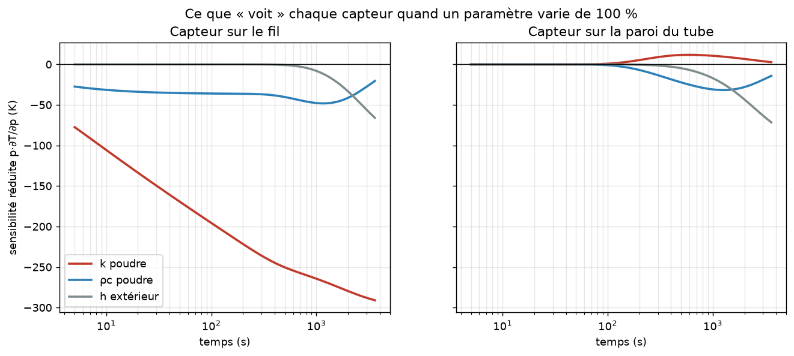
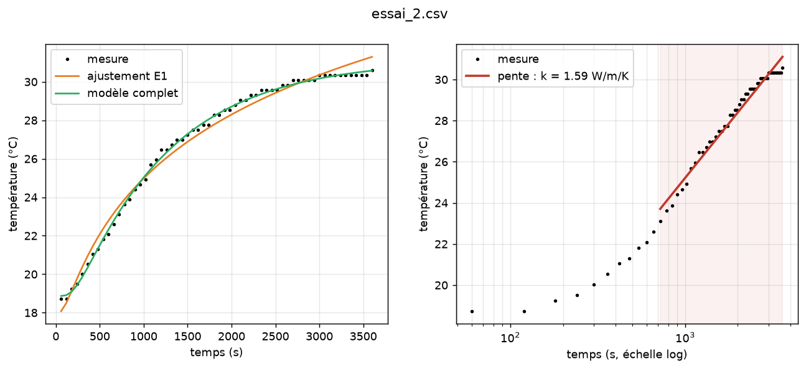
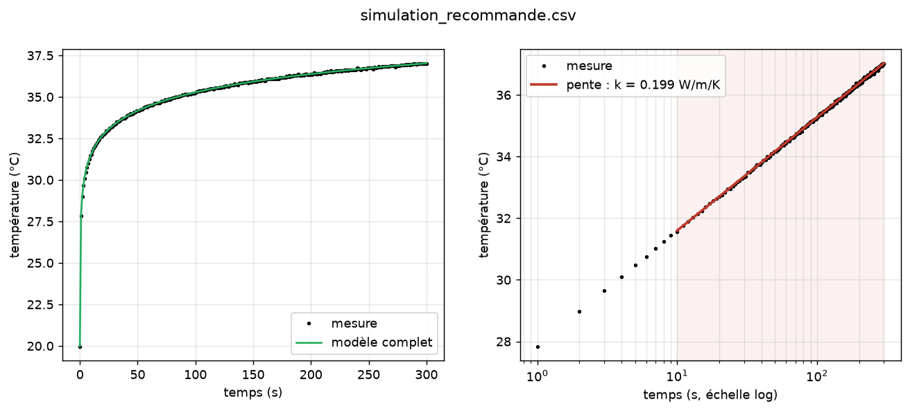

# Conductivité thermique des poudres par la méthode du fil chaud

Projet Protech : on remplit un tube de poudre, on tend au centre un fil
chauffant parcouru par un courant connu, et on suit l'évolution d'une
température au cours du temps. La vitesse à laquelle la température monte
donne la conductivité thermique $k$ de la poudre (en W/m/K).

```
            ┌───────── tube ─────────┐
            │ · · · · · │ · · · · · ·│
            │ · poudre ·│· · · · · · │   P = U·I injectée dans le fil
            │ · · · · · │ · · · · · ·│   q = P / L (W/m)
   PT100 ──►│ · · · · · │ · · · · · ·│◄── capteur collé sur la paroi (v1)
            │ · · · · · │ ◄── fil    │    ou sur le fil (v2, recommandé)
            └────────────────────────┘
```

Cette version 2 apporte :

| | |
|---|---|
| 📘 **Documentation** | la [théorie](docs/theorie.md), le [matériel et le câblage](docs/materiel.md), le [protocole de mesure](docs/protocole.md), l'[utilisation des outils](docs/utilisation.md) et un [audit de la version 1](docs/audit_v1.md) |
| 🧮 **Simulateur physique** | modèle numérique du montage complet (fil + poudre + tube + air), validé contre la solution analytique |
| 🤖 **Arduino virtuel** | produit exactement les mêmes trames que le firmware, avec quantification et bruit du capteur : toute la chaîne se teste **sans matériel** |
| 📈 **Analyse** | trois méthodes (pente en ln t, ajustement E1, problème inverse sur le modèle complet), avec incertitudes |
| 🔌 **Firmware v2** | MAX31865 ou pont diviseur amélioré, commande de la chauffe, sécurités, échantillonnage sans dérive |
| ✅ **Tests** | 16 tests Python (`pytest`) et 7 tests JavaScript (`node --test tests/js/`) |

## Démarrage rapide

Python ≥ 3.11 est nécessaire.

```bash
python -m venv .venv
# Windows : .venv\Scripts\activate    —    Linux/macOS : source .venv/bin/activate
pip install -r requirements.txt

# 1. Dimensionner une expérience (sensibilités, résolution, durée utile)
python -m hotwire design --config config/montage_recommande.toml --duration 300 --plot design.png

# 2. Simuler une mesure complète, comme si l'Arduino était branché
python -m hotwire simulate --config config/montage_recommande.toml --duration 300 --baseline 30 --period 1 --out data/sim.csv --plot sim.png

# 3. En extraire la conductivité
python -m hotwire analyze data/sim.csv --config config/montage_recommande.toml --t-min 10 --t-max 300 --method all --plot analyse.png

# 4. Avec le vrai montage : enregistrer les trames de l'Arduino
python -m hotwire acquire --list-ports
python -m hotwire acquire --port COM3 --out data/essai_poudre_X.csv
```

`python -m hotwire acquire --simulate` lance la même acquisition sur l'Arduino
virtuel, en temps accéléré.

## Ce que montrent la simulation et les données d'origine

**1. Le calcul du tableur d'origine sous-estimait $k$ d'un facteur 2,3.**
La pente avait été mesurée en fonction de $\log_{10}(t)$ alors que la formule
$k = q / (4\pi \cdot \text{pente})$ suppose le logarithme népérien $\ln(t)$.

**2. Avec un capteur collé sur la paroi extérieure du tube, $k$ n'est pas
mesurable de façon fiable.** La figure ci-dessous montre de combien la
température mesurée varie quand on double un paramètre. Sur le fil (à
gauche), elle dépend surtout de $k$. Sur la paroi (à droite), elle dépend
surtout des pertes vers l'air ($h$) et de la capacité thermique ($\rho c$) ;
$k$ n'y joue presque aucun rôle.



Sur les deux essais d'origine, les trois méthodes d'analyse donnent des
valeurs de 0,6 à 1,9 W/m/K. Le modèle complet n'arrive à reproduire les
courbes qu'avec une capacité thermique irréaliste (5 à 18·10⁶ J/m³/K, contre
environ 1·10⁶ pour une poudre). Le bilan d'énergie ne boucle donc pas avec
l'hypothèse d'un tube de 41 mm chauffé uniformément : il y a de fortes pertes
axiales, ou la puissance réellement dissipée dans la poudre est mal connue.
Le détail est dans l'[audit de la v1](docs/audit_v1.md).



**3. La résolution du montage électronique d'origine était d'environ 26 °C
par pas d'ADC.** Une PT100 en pont avec 10 kΩ, lue par l'ADC 10 bits sous
5 V, ne permet pas de suivre des variations de 0,1 Ω. Les données du tableur
viennent donc probablement d'un ohmmètre. Un module MAX31865 donne environ
0,03 °C.

**4. Un montage corrigé donne $k$ à mieux que 1 %, en simulation avec bruit
de mesure.** Il faut un fil fin (Ø 0,1 mm), un tube de Ø 50 mm, un capteur
au contact du fil, 0,8 W de chauffe, un essai de 5 minutes et un
échantillonnage à 1 Hz. Voir le [protocole](docs/protocole.md).



## Site de présentation

Le dossier `site/` contient une page web autonome, sans étape de build. Elle
présente la méthode, propose un simulateur interactif (le modèle numérique
porté en JavaScript), analyse un CSV déposé dans le navigateur et reprend la
réanalyse des essais v1.

* **Voir en local** : `python -m http.server -d site 8000`, puis ouvrir http://localhost:8000.
* **Publier sur GitHub Pages** : dans *Settings → Pages*, choisir la source
  *GitHub Actions*. Le workflow `.github/workflows/pages.yml` publie ensuite
  `site/` à chaque push sur `main`.
* **Mettre à jour les résultats** : `python scripts/build_site_data.py`
  régénère `site/data/results.json` à partir du package Python.
* **Cohérence Python ↔ JavaScript** : `node --test tests/js/` vérifie que le
  simulateur du site reproduit le modèle Python à 10⁻⁶ près.

## Organisation du dépôt

```
hotwire/                 package Python
  model.py               solution analytique + simulation volumes finis
  sensors.py             PT100 (IEC 60751), pont diviseur, MAX31865
  analysis.py            méthodes d'extraction de k, sensibilités
  virtual.py             Arduino virtuel
  acquisition.py         enregistrement série -> CSV (remplace Processing)
  cli.py                 commandes simulate / analyze / acquire / design
site/                    page web (GitHub Pages) : méthode, simulateur, analyse
scripts/                 génération des données du site
firmware/hotwire_logger/ firmware Arduino v2
config/                  descriptions de montages (TOML)
data/                    essais d'origine (extraits du tableur) et simulations
docs/                    documentation détaillée
tests/                   tests automatiques
legacy/                  version 1 d'origine (ino, Processing, tableur), conservée telle quelle
```

## Tests

```bash
pip install -r requirements.txt
pytest
```

Les tests vérifient : le modèle numérique face à la solution exacte, le bilan
d'énergie en régime permanent, l'inversion PT100, la capacité de chaque
méthode à retrouver un $k$ connu, et la chaîne complète Arduino virtuel →
acquisition → analyse.
